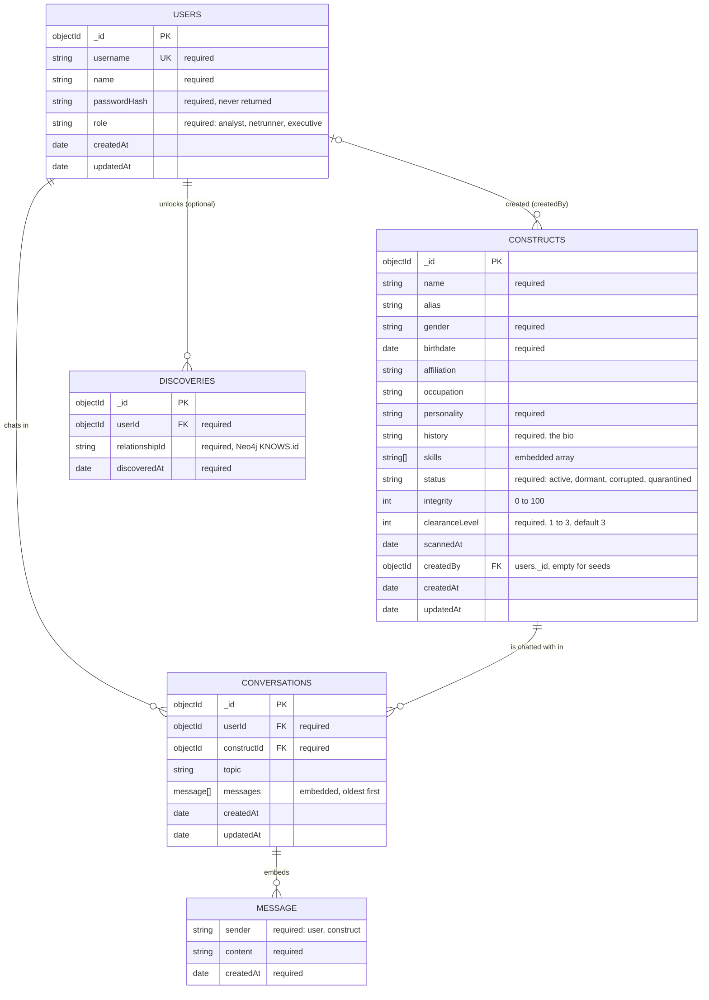
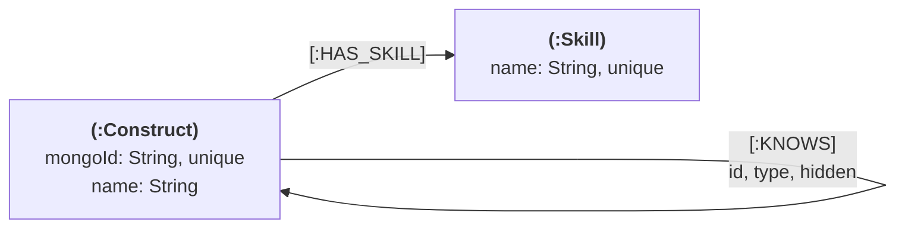
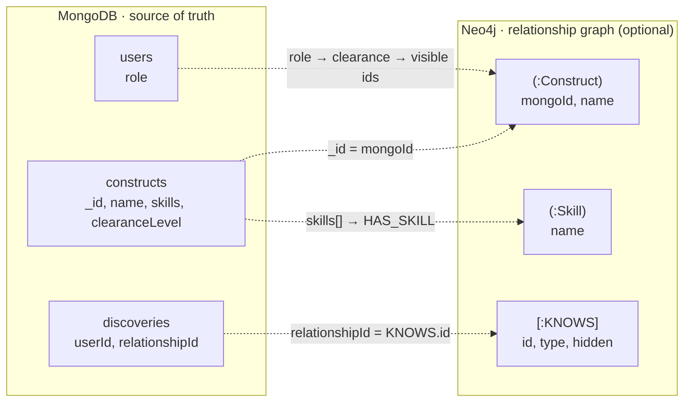

# Database schema

The app stores data in two databases:

- **MongoDB (required)** is the source of truth for users, constructs and conversations. Every API route reads and writes it through Mongoose.
- **Neo4j (optional, backlog cards 35–45)** holds the relationship graph: which constructs know each other and which skills they share. It stores only ids, names and links, never a second copy of construct details.

Files in this folder:

| File | What it's for |
| --- | --- |
| `database-schema.md` | This page: both diagrams and the rules that tie them together |
| `mongodb-schema.dbml` | The MongoDB schema for [dbdiagram.io](https://dbdiagram.io); paste it in to redraw or export the diagram |
| `neo4j-schema.cypher` | Neo4j constraints and sample data; run it in Neo4j Browser |

## 1. MongoDB

Each box is a collection (one Mongoose model), except `MESSAGE`, which is embedded inside each conversation document.



**Design choices**

- **Embed what's read together, reference what's shared.** A construct's skills and a conversation's messages belong to one parent and are always loaded with it, so they're embedded arrays. Users and constructs are referenced by `_id`, because many documents point at them and they change on their own.
- **Clearance comes from the role.** `shared/src/permissions.ts` maps analyst → 1, netrunner → 2, executive → 3, so users have no clearance field that could disagree with their role. Construct queries filter on `clearanceLevel: { $lte: clearanceFor(role) }`.
- **Indexes:** `users.username` (unique); `constructs { clearanceLevel, name }` for the clearance-filtered list sorted by name (cards 10 and 20); `conversations { userId, constructId }`; `discoveries { userId, relationshipId }` (unique, so a discovery is recorded once).
- **The API enforces the links.** MongoDB doesn't check references, so the delete routes clean up after themselves (see section 3).
- **Optional parts:** `conversations` is needed only if the AI chat keeps history (cards 29–30; card 30 currently says history isn't saved). `discoveries` belongs to the Neo4j backlog (cards 44–45).

## 2. Neo4j (optional)



| Element | Properties | Notes |
| --- | --- | --- |
| `(:Construct)` | `mongoId`, `name` | One node per MongoDB construct; `mongoId` is its `_id` as a string |
| `(:Skill)` | `name` | Shared by every construct with that skill; names are trimmed and lowercased before `MERGE` |
| `[:HAS_SKILL]` | none | Construct → Skill, rebuilt from `constructs.skills` whenever a construct is saved |
| `[:KNOWS]` | `id` (String, unique), `type`, `hidden` (Boolean) | Construct → Construct. `type` is family, friend, coworker, enemy or acquaintance (card 39). `id` is a UUID, so a discovery in MongoDB can point at it. Stored in one direction and queried in both, since "knows" goes both ways |

**Constraints** (in `neo4j-schema.cypher`): `Construct.mongoId`, `Skill.name` and `KNOWS.id` are unique. Uniqueness constraints run on the free Community Docker image and AuraDB Free; existence constraints are Enterprise-only, so the API checks required properties before it writes.

## 3. How the two databases connect



**Multiplicity**

| Link | Multiplicity | Stored as |
| --- | --- | --- |
| User created construct | 0..1 user : 0..* constructs | `constructs.createdBy` → `users._id` |
| User has conversations | 1 user : 0..* conversations | `conversations.userId` |
| Construct has conversations | 1 construct : 0..* conversations | `conversations.constructId` |
| Conversation has messages | 1 conversation : 0..* messages | embedded `conversations.messages` |
| Construct has skills | 0..* constructs : 0..* skills | MongoDB `constructs.skills`; Neo4j `HAS_SKILL` |
| Construct knows construct | 0..* : 0..* | Neo4j `KNOWS` |
| User discovered hidden link | 1 user : 0..* discoveries, 1 `KNOWS` : 0..* discoveries | `discoveries.userId`, `discoveries.relationshipId` |
| MongoDB construct to graph node | 1 : 0..1 (exactly 1 once synced) | `Construct.mongoId` |

**Keeping them in sync** (cards 36 and 38): write MongoDB first, then Neo4j. If the Neo4j write fails, the API logs it and `npm run graph:rebuild` redraws the graph from MongoDB.

| Event | MongoDB | Neo4j |
| --- | --- | --- |
| Create or edit a construct | Insert or update the document | `MERGE` the node, set `name`, replace its `HAS_SKILL` links |
| Delete a construct (card 25) | Delete it and its conversations | Collect its `KNOWS` ids, then `DETACH DELETE` the node; delete discoveries with those ids |
| Link two constructs (card 39) | Nothing | `MERGE` a `KNOWS` with a new `id` |
| Remove a link (card 39) | Delete discoveries with that `relationshipId` | Delete the `KNOWS` |
| Delete a user (no card yet) | Delete their conversations and discoveries; clear `createdBy` on their constructs | Nothing |

**Clearance stays in one place.** The graph doesn't store clearance. `/api/graph` (card 40) first runs the normal MongoDB clearance query, then passes the visible construct ids to Neo4j, so the graph can never show a construct the user can't open:

```cypher
// $visibleIds: construct _ids from the MongoDB clearance query
// $discoveredIds: relationshipIds from this user's discoveries
MATCH (a:Construct)-[k:KNOWS]-(b:Construct)
WHERE a.mongoId IN $visibleIds AND b.mongoId IN $visibleIds
  AND (k.hidden = false OR k.id IN $discoveredIds)
RETURN DISTINCT k.id AS id, startNode(k).mongoId AS source,
       endNode(k).mongoId AS target, k.type AS type;
```

## 4. Normalization and duplication

- **No field depends on another non-key field.** Clearance is derived from `role` in code rather than stored beside it, so the two can't disagree.
- **Each user and construct is stored once.** Everything else refers to it by `_id`.
- **Embedded arrays don't duplicate data.** Each message and skill list belongs to exactly one parent document.
- **Two deliberate copies:** the construct `name` is copied to its Neo4j node so the graph has readable labels (sync updates it on rename), and skill names repeat as strings across construct documents. The Neo4j `Skill` nodes are the de-duplicated form of the skills.

## 5. Other queries the API will run

```cypher
// Save a construct (card 38): upsert the node and replace its skills
MERGE (c:Construct {mongoId: $id})
SET c.name = $name
WITH c
OPTIONAL MATCH (c)-[old:HAS_SKILL]->()
DELETE old
WITH DISTINCT c
UNWIND $skills AS skillName
MERGE (s:Skill {name: toLower(trim(skillName))})
MERGE (c)-[:HAS_SKILL]->(s);

// Link two constructs (card 39); an existing link in either direction is reused
MATCH (a:Construct {mongoId: $from})
MATCH (b:Construct {mongoId: $to})
MERGE (a)-[k:KNOWS]-(b)
  ON CREATE SET k.id = randomUUID()
SET k.type = $type, k.hidden = $hidden
RETURN k.id AS id;

// Find a hidden link between two constructs (card 45)
MATCH (a:Construct {mongoId: $a})-[k:KNOWS {hidden: true}]-(b:Construct {mongoId: $b})
RETURN k.id AS id, k.type AS type;

// Skills two constructs share (card 35)
MATCH (a:Construct {mongoId: $a})-[:HAS_SKILL]->(s:Skill)<-[:HAS_SKILL]-(b:Construct {mongoId: $b})
RETURN s.name AS skill;
```
